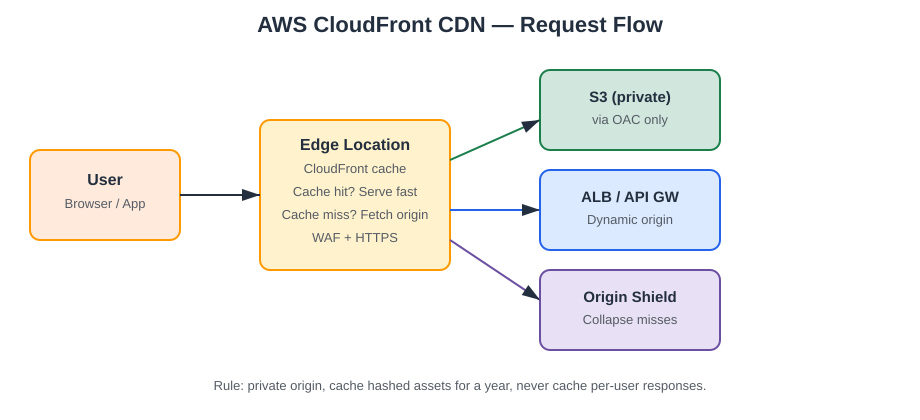

# AWS CloudFront CDN Guide


> Serve content fast, cheap, and secure from the edge — without turning your
> origin into a bottleneck or a public target.

## TL;DR

- **CloudFront** is AWS's content delivery network (CDN): 400+ edge locations
  cache your content close to users, so a request from Jakarta doesn't have to
  travel to an origin in Virginia.
- Put **S3 (private) + Origin Access Control (OAC)** behind CloudFront for
  static sites, and **ALB / API Gateway / EC2** behind it for dynamic apps.
- Cache aggressively for static assets, cache nothing (or almost nothing) for
  personalized responses — the cache policy is where most CloudFront bugs live.
- Never expose the S3 bucket publicly. OAC + a bucket policy that only allows
  the CloudFront distribution is the whole security model for a static site.
- The expensive mistakes are: no compression, no cache headers from the
  origin, invalidations as a deployment strategy, and forgetting that
  **data transfer out of CloudFront is cheaper than out of S3/EC2 directly**.

## Architecture



```
User ──► Edge Location (cache?) ── hit ──► cached response (fast, cheap)
                              └── miss ──► Origin (S3 via OAC / ALB / API GW)
                                            └── back through edge, cached per policy
```

## How a request flows

1. **DNS** resolves your domain (or `*.cloudfront.net`) to the nearest edge
   location via latency-based routing.
2. **Viewer request**: CloudFront checks the cache key — by default just the
   URL path. Query strings, headers, and cookies are only part of the key if
   your cache policy says so. This is the #1 cause of "wrong user sees
   someone else's page": forwarding `Cookie: session` into the cache key
   (or worse, not forwarding it while caching a personalized page).
3. **Cache hit** → response straight from the edge, no origin call.
4. **Cache miss** → origin request, with an Origin Request Policy controlling
   which headers/query strings/cookies reach the origin.
5. **Origin response** → CloudFront applies the TTL from the cache policy
   (or the origin's `Cache-Control` header), stores it, and serves it.

## Cache policies: the decision table

| Content type | Cache policy | TTL | Forward to origin |
|---|---|---|---|
| Hashed static assets (`app.a1b2c3.js`) | `CachingOptimized` | 1 year | Nothing |
| Images, fonts, CSS without hash | `CachingOptimized` | 1 day | Nothing |
| HTML pages (SPA shell) | Short TTL or no-cache | 0–60 s | Nothing |
| API responses (public, shared) | Custom, keyed on query string | 60 s–5 min | Query string only |
| API responses (per-user) | `CachingDisabled` | 0 | Auth header / cookies |

**Rule of thumb:** if the filename contains a content hash, cache it for a
year. If it doesn't, assume it will change and keep the TTL short — and use
versioned deployments, not invalidations, to roll out new assets.

## Origin comparison

| Origin | Best for | Watch out for |
|---|---|---|
| S3 + OAC | Static sites, media, downloads | Bucket must stay private; no server-side logic |
| Application Load Balancer | Dynamic web apps, SSR | Origin must handle its own auth; set origin timeouts |
| API Gateway | REST/WebSocket APIs at the edge | API Gateway already has its own edge; CloudFront adds custom-domain + WAF control |
| EC2 / custom HTTP server | Legacy apps you can't move | Keep-alive and timeout tuning matters; use an origin group for failover |
| S3 website endpoint | Nothing new | No OAC support — use the S3 REST endpoint with OAC instead |

## Security checklist

- [ ] S3 bucket is **private**; bucket policy allows only the CloudFront
      distribution ARN (`AWS:SourceArn`).
- [ ] OAC (not the legacy OAI) is attached to the origin.
- [ ] Viewer protocol policy is **Redirect HTTP to HTTPS** (or HTTPS only).
- [ ] WAF web ACL attached for rate limiting and managed rules on public
      distributions.
- [ ] Signed URLs / signed cookies for paid or private content — never
      "security by obscurity" via an unlisted path.
- [ ] `Origin Shield` enabled if you have a high miss rate or a fragile
      origin: one extra caching layer in a regional shield region collapses
      many edge misses into a single origin request.
- [ ] Real-time logs or standard access logs on, shipped to S3, so you can
      actually debug a cache or WAF problem.

## Cost levers

1. **Cache hit ratio** is the biggest lever: every miss is an origin fetch
   plus origin data-transfer cost.
2. **Price classes**: `PriceClass_100` (US/EU only) is cheapest; use it if
   your users are concentrated there, `PriceClass_All` if they're global.
3. **Compression**: enable Brotli/Gzip — smaller payloads, lower transfer
   cost, faster loads.
4. **Invalidations**: the first 1,000 paths/month are free, then you pay.
   Versioned filenames make invalidations unnecessary.
5. **Field-level encryption / signed URLs** add cost and complexity — only
   for content that genuinely needs it.

## Common mistakes

| Mistake | Symptom | Fix |
|---|---|---|
| Caching a personalized page | Users see each other's data | `CachingDisabled` or key on the session cookie |
| Forwarding all headers to cache | Cache hit ratio near zero | Forward only what changes the response |
| S3 bucket left public | Origin bypassable directly | Private bucket + OAC-only bucket policy |
| Invalidating on every deploy | Slow deploys, invalidation bills | Hashed asset filenames + short HTML TTL |
| No `Cache-Control` from origin | Surprising TTLs | Set headers at the origin; policy TTL is the ceiling |
| HTTP allowed | Mixed-content / downgrade risk | Redirect HTTP to HTTPS |

## Deploy it

The Terraform in `examples/cloudfront-s3-oac.tf` creates a private S3 bucket,
a CloudFront distribution with OAC, HTTPS redirect, compression, and a
least-privilege bucket policy — the full static-site pattern in one file.

```bash
terraform init
terraform apply
# Upload your site:
aws s3 sync ./dist s3://$(terraform output -raw bucket_name)
```

## Quiz teaser

Can you spot why a SPA's `index.html` should never get a 1-year TTL — and
what breaks first if it does? Take the full quiz in [`quiz.md`](quiz.md).

## Further reading

- AWS docs: CloudFront cache policies, origin request policies, OAC
- AWS docs: CloudFront + WAF, signed URLs and signed cookies
- AWS Well-Architected: Performance Efficiency pillar (caching)
